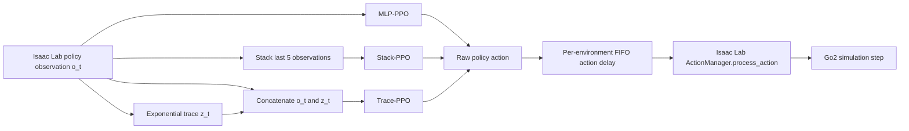

# Memory Trace Delay

**Do Memory Traces Improve Delay-Robust Quadrupedal Locomotion? A Controlled Study with PPO**

This repository studies whether short-term observation memory improves the robustness of a Unitree Go2 locomotion policy when commanded actions are executed with delay. The project is built as an external [Isaac Lab](https://isaac-sim.github.io/IsaacLab/v2.3.2/) project and uses the official Go2 flat-terrain velocity-tracking task and RSL-RL PPO configuration as its baseline.

The main comparison is between a memoryless MLP policy, a five-observation stack, and an exponential memory trace. Action delay is the experimental disturbance; rewards, terminations, robot model, terrain, and PPO hyperparameters are otherwise inherited from the same official Go2 task.

## Research question

> Does giving PPO a compact history representation improve locomotion performance when action execution is delayed?

The final evaluation grid uses every fixed delay from 0 through 6 environment steps. With the current `step_dt=0.02 s`, this spans 0 to 120 ms in 20 ms increments.

## Method

### Action-delay model

For parallel environment `i`, one delay is sampled at episode reset and remains fixed for that episode:

```text
d_i ~ Uniform{delay_min, ..., delay_max}
executed_action_i(t) = policy_action_i(t - d_i)
```

The pure PyTorch FIFO is implemented in `action_delay.py`. It maintains independent histories and delays for every parallel environment, supports partial resets and CUDA tensors, and is inserted immediately before `ActionManager.process_action()`.

The history is zero-filled after reset. For `d=0`, the buffer returns the action written during the same step and does not consume random-number-generator state, preserving the baseline action path.

### Compared methods

| Key | Policy input | Training delay |
| --- | --- | --- |
| `train0` | Current observation `o_t` | Fixed `d=0` |
| `train2` | Current observation `o_t` | Fixed `d=2` |
| `train0to4` | Current observation `o_t` | Episode-fixed random `d in [0,4]` |
| `stack5_train0` | Five flattened policy observations | Fixed `d=0` |
| `stack5_train2` | Five flattened policy observations | Fixed `d=2` |
| `stack5` | Five flattened policy observations | Episode-fixed random `d in [0,4]` |
| `trace08_train0` | Current observation plus exponential trace `[o_t, z_t]` | Fixed `d=0` |
| `trace08_train2` | Current observation plus exponential trace `[o_t, z_t]` | Fixed `d=2` |
| `trace08` | Current observation plus exponential trace `[o_t, z_t]` | Episode-fixed random `d in [0,4]` |
| `stack2` | Two flattened policy observations | Episode-fixed random `d in [0,4]` |
| `stack8` | Eight flattened policy observations | Episode-fixed random `d in [0,4]` |
| `trace05` | Current observation plus trace with decay 0.5 | Episode-fixed random `d in [0,4]` |
| `trace0875` | Current observation plus trace with decay 0.875 | Episode-fixed random `d in [0,4]` |

The Trace-PPO state is

```text
z_t = 0.8 z_(t-1) + 0.2 o_t
policy_input_t = concat(o_t, z_t)
```

Trace state is maintained separately for each environment and cleared only for environments that reset. The main decay 0.8 has the approximate memory horizon `1 / (1 - 0.8) = 5` steps, matching the Stack-5 comparison. The ablation compares Stack windows `K in {2,5,8}` and trace decays `{0.5,0.8,0.875}`, with approximate horizons `{2,5,8}` steps. These ablations change only the policy memory input; the task, delay distribution, rewards, PPO configuration, and evaluation budget remain fixed.

### Data flow



### Evaluation protocol

Each tracked evaluation currently uses:

- 256 parallel environments;
- 1,024 completed episodes;
- evaluation seeds 123, 124, and 125;
- fixed test delay `d in {0,1,2,3,4,5,6}`;
- disabled observation corruption, robot pushes, and external force/torque events;
- metrics for episode return, episode length, pre-action XY/yaw tracking error, failure rate, and timeout rate.

## Registered tasks

| Gym task ID | Purpose |
| --- | --- |
| `MemoryTrace-Velocity-Flat-Unitree-Go2-v0` | Memoryless MLP baseline with action delay |
| `MemoryTrace-Stack-Velocity-Flat-Unitree-Go2-v0` | Stack-5 observation baseline |
| `MemoryTrace-Trace-Velocity-Flat-Unitree-Go2-v0` | Exponential Trace-PPO |

All three environments inherit from the official `UnitreeGo2FlatEnvCfg`. Their RSL-RL configurations inherit from the official `UnitreeGo2FlatPPORunnerCfg`; only experiment log names and policy-input construction differ.

## Current project status

Status below describes files currently tracked in this repository. A checkpoint or result that exists only on the Ubuntu workstation is not counted until its metadata/result JSON is copied into the repository.

| Component | Status | Evidence |
| --- | --- | --- |
| Isaac Sim / Isaac Lab / Go2 baseline | Complete | Official task trained, played, and exported on Ubuntu |
| Pure PyTorch action-delay FIFO | Complete | CPU/CUDA, `d=0`, per-environment delay, and partial reset tests |
| Isaac Lab action-delay integration | Complete | Raw action is delayed before `ActionManager.process_action()` |
| Nine-condition core study | Complete | MLP, Stack-5, and Trace at three training-delay conditions and seeds 42-44 |
| Core evaluation snapshot | Complete | 108 JSON files: 9 methods x 3 training seeds x 4 delays x evaluation seed 123 |
| Trace implementation and task registration | Complete in code | Buffer, RSL-RL wrapper, task config, debug script, and tests |
| Full controlled retraining | Configured; ready for Ubuntu | All 45 models are trained in new timestamped runs |
| Training-time validation | Complete in code | Checkpoints 100/200/300/400/499 use seeds 901/902 and delays 0/2/4/6 |
| Memory-horizon ablations | Configured; ready for retraining | Stack `K={2,5,8}` and Trace decay `{0.5,0.8,0.875}` |
| Expanded final evaluation | Configured; not yet tracked | Best models, three test seeds, and every delay from 0 through 6 |
| Split final figures | Complete in code | Training-condition, architecture, retention, improvement, ablation, robustness, and seed-stability views |
| Engineering comparison | Complete in code | TensorBoard efficiency, checkpoint validation, policy latency/size, and Pareto scripts |

The current configuration intentionally retrains the complete 45-model matrix. New timestamped log directories preserve all older checkpoints. Training-time validation creates `best_model.pt` inside each new run, and the final 945-condition evaluation is written under `results/final_best/` so the tracked preliminary snapshot is not overwritten.

## Preliminary tracked results

The tracked 108-file snapshot is sufficient for the original nine-condition, three-training-seed comparison. It is not yet the final ablation study because it contains only evaluation seed 123 and the even test delays 0, 2, 4, and 6. Run the configured extension before treating small method differences as final conclusions.

Existing artifacts are stored under:

```text
results/mlp/                 MLP evaluation JSON files
results/stack/               Stack-5 evaluation JSON files
results/figures/             Current MLP/Stack plots
results/combined_summary.csv Combined tracked summary
results/final_best/          New validation-selected final study outputs
```

Training checkpoints and TensorBoard logs are intentionally ignored by Git and remain under `logs/rsl_rl/` on the machine that performed training.

## Validated runtime

The laboratory workstation configuration used for the tracked experiments is:

| Component | Version |
| --- | --- |
| OS | Ubuntu 22.04 x86_64 |
| Python | 3.11 |
| Isaac Sim | 5.1.0 |
| Isaac Lab | v2.3.2, commit `37ddf626871758333d6ed89cf64ad702aef127d0` |
| PyTorch | 2.7.0 + CUDA 12.8 |
| RSL-RL | 3.1.2 |
| Robot/task | Unitree Go2, flat-terrain velocity tracking |

Isaac Sim and Isaac Lab must be installed before running simulator tests or training. Follow the official [Isaac Lab v2.3.2 installation guide](https://isaac-sim.github.io/IsaacLab/v2.3.2/source/setup/installation/index.html). Isaac Sim 5.x requires Python 3.11.

## Installation

### Ubuntu: simulator, training, and evaluation

Install Isaac Sim 5.1.0 and Isaac Lab v2.3.2 in a Python 3.11 environment first. Then install this external project in editable mode:

```bash
git clone <repository-url>
cd memory_trace_delay
conda activate <isaaclab-environment>
python -m pip install -e source/memory_trace_delay
```

The editable installation is required so Python can import `memory_trace_delay.tasks` and register the Gym environments. It normally needs to be run once per Python environment; subsequent Git pulls immediately expose source-file edits.

Dependency files have different purposes:

| File | Purpose |
| --- | --- |
| `requirements-ubuntu.txt` | Small reference list for the validated Ubuntu runtime |
| `requirements-lock-linux.txt` | Exact Linux package snapshot for reproducibility/debugging |
| `requirements.txt` | Full workstation freeze, including Isaac Lab source references |
| `requirements-dev.txt` | Portable Windows/Linux environment for unit tests and analysis only |

Do not install the full workstation freeze blindly into an existing Isaac Lab environment. Prefer the official Isaac Lab installation procedure, then install this project with `pip install -e`.

### Windows: editing and pure PyTorch tests

Isaac Sim is not needed for buffer tests, result parsing, command generation, or static analysis:

```powershell
cd D:\memTrace\memory_trace_delay
conda activate memory-trace
python -m pip install -r requirements-dev.txt
python -m pytest -p no:cacheprovider tests -q
```

Simulator integration and PPO training should be run on the Ubuntu workstation.

## Verification

### Portable unit tests

```bash
python -m pytest -p no:cacheprovider tests -q
python -m ruff check source scripts tests
```

The current local test result is `74 passed, 3 skipped`; the skipped cases require CUDA.

### Ubuntu Isaac Lab checks

Run these after activating the validated Isaac Lab environment:

```bash
python scripts/check_go2_registration.py

python scripts/debug_action_delay.py \
  --headless --device cuda:0 --num_envs 4 --delay 2 --steps 5

python scripts/debug_memory_trace.py \
  --headless --device cuda:0 --num_envs 4 --steps 5
```

The two debug scripts should end with `[ACTION_DELAY] PASS` and `[MEMORY_TRACE] PASS`.

## Running experiments from one JSON file

The complete experiment suite is described by:

```text
configs/experiments/all_algorithms.json
```

The runner expands each enabled method and training seed into an independent job. GPU workers pull jobs from a shared queue, so a completed GPU immediately starts the next waiting job. After all training jobs finish, evaluation jobs use the same GPU pool; analysis runs once after evaluation.

Always inspect the generated commands first:

```bash
python scripts/run_experiments.py \
  --config configs/experiments/all_algorithms.json \
  --dry-run
```

Run the configured suite:

```bash
python scripts/run_experiments.py \
  --config configs/experiments/all_algorithms.json
```

The current JSON defaults implement a clean retraining protocol:

- GPUs 0-2 run three independent training jobs; GPU 3 is reserved for training-time validation;
- all fixed-delay, random-delay, and memory-ablation models are retrained in new runs;
- random-delay MLP, Stack-5, and Trace-0.8 use training seeds 42-46;
- every other controlled condition and ablation uses training seeds 42-44;
- checkpoints 100, 200, 300, 400, and final 499 are validated with seeds 901/902 at delays 0/2/4/6;
- every run continuously maintains its own `best_model.pt` and `best_checkpoint.json`;
- evaluation covers the main random-delay methods at training seeds 42-46 and all other methods at seeds 42-44;
- after all training completes, GPUs 0-3 evaluate only the selected best models with test seeds 123-125 at delays 0-6;
- analysis enabled after all selected jobs.

The full configuration creates 45 training jobs. Validation is serialized on GPU 3 with a file lock, so simultaneous training processes cannot overload it. Final evaluation creates 945 JSON files under `results/final_best/`, with four evaluation jobs running concurrently.

Useful command-line selections:

```bash
# Train/evaluate only Trace-PPO, then update the combined analysis.
python scripts/run_experiments.py --config configs/experiments/all_algorithms.json --only trace08

# Evaluate an existing Trace checkpoint without retraining.
python scripts/run_experiments.py --config configs/experiments/all_algorithms.json --only trace08 --skip-train

# Train Trace without evaluation or analysis.
python scripts/run_experiments.py --config configs/experiments/all_algorithms.json --only trace08 --skip-eval --skip-analysis

# Select two methods. Repeat --only for additional methods.
python scripts/run_experiments.py --config configs/experiments/all_algorithms.json --only stack5 --only trace08

# Run the three Stack-PPO training-delay conditions.
python scripts/run_experiments.py --config configs/experiments/all_algorithms.json --only stack5_train0 --only stack5_train2 --only stack5

# Run the three Trace-PPO training-delay conditions.
python scripts/run_experiments.py --config configs/experiments/all_algorithms.json --only trace08_train0 --only trace08_train2 --only trace08

# Run only the four new memory-horizon ablations.
python scripts/run_experiments.py --config configs/experiments/all_algorithms.json \
  --only stack2 --only stack8 --only trace05 --only trace0875

# List configured method keys.
python scripts/run_experiments.py --config configs/experiments/all_algorithms.json --list-methods
```

### Configuration switches

Every method supports independent stage control:

```json
{
  "key": "trace08",
  "enabled": true,
  "training": {
    "enabled": true,
    "delay_min": 0,
    "delay_max": 4,
    "extra_args": []
  },
  "evaluation": {
    "enabled": true,
    "extra_args": []
  }
}
```

- `method.enabled=false` skips the entire method;
- `training.enabled=false` reuses `checkpoint_glob` or an explicit checkpoint;
- `training.validation.enabled=false` disables online checkpoint selection for that method;
- `evaluation.enabled=false` trains without evaluating;
- `analysis.enabled=false` disables final CSV/plot generation;
- `extra_args` accepts additional normal CLI flags or Hydra overrides.

The global GPU pool and concurrency limits are configured separately:

```json
"execution": {
  "training_gpus": [0, 1, 2],
  "validation_gpu": 3,
  "evaluation_gpus": [0, 1, 2, 3],
  "training_workers": 3,
  "evaluation_workers": 4
}
```

Each active worker runs one child process on its assigned GPU. The validation GPU must not appear in `training_gpus`; it may appear in `evaluation_gpus` because final evaluation begins only after training has finished. Set worker counts to `1` for serial execution.

The common online-validation configuration is also editable in JSON:

```json
"validation": {
  "enabled": true,
  "seeds": [901, 902],
  "test_delays": [0, 2, 4, 6],
  "interval": 100,
  "start_iteration": 100,
  "num_envs": 256,
  "num_episodes": 256
}
```

For example, a method may override the common environment count, logger, or Hydra configuration:

```json
"training": {
  "enabled": true,
  "num_envs": 2048,
  "extra_args": [
    "--logger",
    "tensorboard",
    "env.memory_trace.decay=0.8"
  ]
}
```

If an environment parameter such as trace decay is changed for training, the same override must be used for evaluation.

### Multiple seeds

Change the common training and evaluation seed lists in the JSON configuration:

```json
"training": {
  "seeds": [42, 43, 44, 45, 46]
},
"evaluation": {
  "training_seeds": [42, 43, 44, 45, 46],
  "seeds": [123, 124, 125]
}
```

`training.seeds` selects models that will be trained by this run. `evaluation.training_seeds` selects trained models to evaluate, while `evaluation.seeds` controls evaluation randomness. The lists are separate so an existing checkpoint can be evaluated without scheduling another training run.

New result filenames contain both seeds to avoid overwriting independent models:

```text
trace08_train0to4_trainseed43_test6_evalseed123.json
```

The analysis first averages repeated evaluation seeds within one trained model and then reports variation across training seeds.

## Result analysis

Analysis can be run independently after result JSON files are available:

```bash
python scripts/analyze_delay_results.py \
  --mlp_dir results/final_best/mlp \
  --stack_dir results/final_best/stack \
  --trace_dir results/final_best/trace \
  --output_csv results/final_best/combined_summary.csv \
  --figure_dir results/final_best/figures
```

The analyzer supports both the legacy single-seed filenames already tracked in this repository and the newer explicit training/evaluation-seed filenames.

It produces three broad all-method appendix plots plus ten less crowded final-study views:

- return, XY error, and failure rate split by training condition;
- return split by policy architecture;
- a three-metric comparison of the main random-delay policies;
- return retention relative to each trained model's own delay-zero return;
- paired Stack/Trace return improvement over the random-delay MLP with the same training seed;
- paired Stack-window and Trace-decay ablation panels;
- normalized delay-AUC, worst-case return, and mean-failure summaries;
- training-seed stability at the largest evaluated delay.

## Engineering comparison and checkpoint selection

Three portable scripts turn the existing training artifacts into the engineering comparisons used in the final report. They do not alter rewards, observations, terminations, PPO settings, checkpoints, or evaluation JSON files.

### Training throughput and wall-clock time

RSL-RL already writes FPS, collection time, learning time, and mean reward to TensorBoard. This command discovers the newest configured run for every selected training seed and aggregates those scalars:

```bash
python scripts/analyze_training_efficiency.py \
  --config configs/experiments/all_algorithms.json \
  --method train0to4 \
  --method stack5 \
  --method trace08
```

Outputs:

```text
results/training_efficiency.csv
results/figures/training_fps_comparison.png
results/figures/training_wall_time_comparison.png
```

The first ten iterations are excluded from FPS by default because simulator and compiler warm-up can distort throughput. The CSV separates PPO collection/learning time, validation wall time (including time waiting for the shared GPU), and their end-to-end total. If a resumed run contains the same scalar step twice, the newest value is retained.

### Training-time checkpoint selection

Checkpoint selection now runs inside every RSL-RL training job. The normal RSL-RL save operation completes first; when a candidate iteration is due, the training process launches deterministic evaluation on reserved GPU 3 and waits for it to finish. The training environment remains untouched, and optimizer/model state stays in memory.

The predeclared candidate grid is:

```text
iterations:       100, 200, 300, 400, 499
validation seeds: 901, 902
validation delays: 0, 2, 4, 6
validation budget: 256 environments, 256 episodes per condition
```

Within one validation seed, the 256 environments are evenly divided among the four delays, so all delays run simultaneously with paired randomness. One checkpoint therefore launches Isaac Sim twice (once for seed 901 and once for 902), rather than eight separate times.

Every validation point is written inside its training run:

```text
<run>/validation/iter_0100/*.json
<run>/validation/checkpoint_summary.csv
<run>/best_checkpoint.json
<run>/best_model.pt
```

The ranking rule is highest normalized Delay-AUC, then highest worst-delay return, then lowest mean failure rate, then latest iteration. TensorBoard receives `Validation/delay_auc`, `Validation/worst_return`, `Validation/mean_failure_rate`, and `Validation/became_best` at each candidate iteration.

GPU 3 uses a cross-process file lock. If three training jobs reach validation simultaneously, one validates while the other two wait; they never start overlapping Isaac Sim validation processes on the same GPU. A validation failure fails that training job instead of silently falling back to its latest checkpoint.

After training, `run_experiments.py` requires `best_model.pt` and automatically uses it for final test seeds 123-125. `select_best_checkpoint.py` remains only as a recovery/audit tool for older runs that were trained before online validation existed.

### Parameters and deployment-side inference latency

`scripts/rsl_rl/play.py` already exports `exported/policy.pt` and `exported/policy.onnx` beside the loaded checkpoint. Benchmark each selected policy on the same quiet machine, backend, device, warm-up, and repetition count. For example:

```bash
python scripts/benchmark_policy.py \
  --model logs/rsl_rl/<experiment>/<run>/exported/policy.pt \
  --method trace08 \
  --training_seed 42 \
  --backend torchscript \
  --device cpu \
  --warmup 1000 \
  --repetitions 10000 \
  --output results/final_best/benchmarks/trace08_trainseed42_torchscript_cpu.json
```

Repeat the command for `train0to4`, `stack5`, and `trace08`, and for each reported training seed. The method key automatically selects the correct 48-dimensional MLP, 240-dimensional Stack-5, or 96-dimensional Trace preprocessing. `--input_dim` is available only as an explicit override and is checked against that preprocessing configuration.

Each JSON under `results/final_best/benchmarks/` records parameter count, approximate linear-layer MACs, model file size, model-only latency, and end-to-end latency including Stack/Trace state preparation. This is policy-side deployment latency; it deliberately excludes Isaac Sim physics and observation construction. ONNX benchmarking additionally requires `onnxruntime`, now included in `requirements-dev.txt`.

Once benchmark JSON files exist, the normal delay analyzer automatically joins them with the main methods' Delay-AUC and adds:

```text
results/final_best/engineering_summary.csv
results/final_best/figures/performance_vs_parameters.png
results/final_best/figures/performance_vs_latency.png
```

Only records with the configured common backend and device are compared. The default experiment configuration uses TorchScript on CPU so GPU scheduling noise does not mix with the final policy comparison. If no matching benchmark files exist, the engineering plots are skipped and all original analysis still completes.

## Repository structure

```text
memory_trace_delay/
├── configs/experiments/
│   └── all_algorithms.json       Unified experiment matrix
├── results/                      Tracked evaluation JSON, CSV, and figures
├── scripts/
│   ├── run_experiments.py        JSON-driven train/evaluate/analyze runner
│   ├── select_best_checkpoint.py Recovery tool for legacy offline runs
│   ├── benchmark_policy.py       TorchScript/ONNX size and latency benchmark
│   ├── analyze_training_efficiency.py TensorBoard FPS/time aggregation
│   ├── debug_action_delay.py     Isaac Lab action-pipeline check
│   ├── debug_memory_trace.py     Isaac Lab trace recurrence/reset check
│   ├── analyze_delay_results.py  Multi-method, multi-seed analysis
│   └── rsl_rl/
│       ├── train.py
│       ├── training_validation.py
│       ├── evaluate_delay.py
│       └── play.py
├── source/memory_trace_delay/
│   └── memory_trace_delay/
│       ├── action_delay.py       Pure PyTorch FIFO
│       ├── action_delay_env.py   ManagerBasedRLEnv integration
│       ├── memory_trace.py       Pure PyTorch exponential trace
│       ├── rsl_rl_trace_wrapper.py
│       └── tasks/                Gym, environment, and PPO configs
└── tests/                        Portable unit tests
```

## Remaining work

The earlier tracked study remains available as a preliminary snapshot. The final workflow is:

1. On Ubuntu, smoke-test one MLP, Stack, and Trace job through the first online validation point.
2. Retrain the complete 45-model matrix with the same 500-update budget and online selection rule.
3. Let the unified runner evaluate every selected `best_model.pt` at delays 0-6 with test seeds 123-125.
4. Export and benchmark the selected main-study policies on one consistent machine.
5. Regenerate the `results/final_best/` CSV files and figures.
6. Report mean and standard deviation across independently trained models, keeping ablation conclusions separate from the main controlled comparison.

Recommended engineering cleanup before a public/final release:

- add a root `LICENSE` file and reconcile the BSD-3-Clause source headers with the Apache-2.0 value in `setup.py`;
- replace template title, author, repository, and description fields in `extension.toml`;
- update the template-only changelog;
- remove or document unused template files such as `ui_extension_example.py` and the currently unreferenced custom reward example;
- optionally add continuous integration for portable unit tests and Ruff.

Multi-trace and recurrent policies such as GRU are optional extensions. They are not required for the minimum MLP-versus-Stack-versus-Trace controlled study.

## Reproducibility notes

- Keep the same task, reward, termination, PPO configuration, training iteration budget, and seed set across compared memory methods.
- Record both training and evaluation seeds; they represent different sources of variation.
- Do not compare different trace decays unless they are explicitly labeled as an ablation.
- Preserve each run's `params/env.yaml`, `params/agent.yaml`, checkpoint path, Git commit, and result JSON.
- Training logs and checkpoints are ignored by Git; copy only the required result metadata or archive large artifacts separately.
