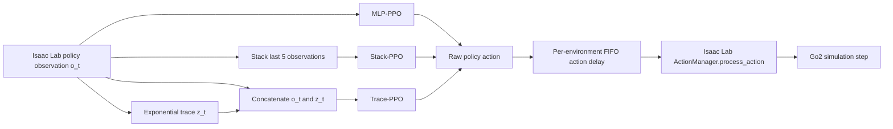

# Memory Trace Delay

**Do Memory Traces Improve Delay-Robust Quadrupedal Locomotion? A Controlled Study with PPO**

This repository studies whether short-term observation memory improves the robustness of a Unitree Go2 locomotion policy when commanded actions are executed with delay. The project is built as an external [Isaac Lab](https://isaac-sim.github.io/IsaacLab/v2.3.2/) project and uses the official Go2 flat-terrain velocity-tracking task and RSL-RL PPO configuration as its baseline.

The main comparison is between a memoryless MLP policy, a five-observation stack, and an exponential memory trace. Action delay is the experimental disturbance; rewards, terminations, robot model, terrain, and PPO hyperparameters are otherwise inherited from the same official Go2 task.

## Research question

> Does giving PPO a compact history representation improve locomotion performance when action execution is delayed?

The project evaluates policies at fixed delays of 0, 2, 4, and 6 environment steps. With the current `step_dt=0.02 s`, these correspond to 0, 40, 80, and 120 ms.

## Method

### Action-delay model

For parallel environment `i`, one delay is sampled at episode reset and remains fixed for that episode:

```text
d_i ~ Uniform{delay_min, ..., delay_max}
executed_action_i(t) = policy_action_i(t - d_i)
```

The pure PyTorch FIFO is implemented in `action_delay.py`. It maintains independent histories and delays for every parallel environment, supports partial resets and CUDA tensors, and is inserted immediately before `ActionManager.process_action()`.

The history is zero-filled after reset. For `d=0`, the buffer returns the action written during the same step and does not consume random-number-generator state, preserving the baseline action path.

### Compared methods

| Key | Policy input | Training delay |
| --- | --- | --- |
| `train0` | Current observation `o_t` | Fixed `d=0` |
| `train2` | Current observation `o_t` | Fixed `d=2` |
| `train0to4` | Current observation `o_t` | Episode-fixed random `d in [0,4]` |
| `stack5` | Five flattened policy observations | Episode-fixed random `d in [0,4]` |
| `trace08` | Current observation plus exponential trace `[o_t, z_t]` | Episode-fixed random `d in [0,4]` |

The Trace-PPO state is

```text
z_t = 0.8 z_(t-1) + 0.2 o_t
policy_input_t = concat(o_t, z_t)
```

Trace state is maintained separately for each environment and cleared only for environments that reset. The approximate memory horizon `1 / (1 - 0.8) = 5` steps was chosen to match the Stack-5 comparison.

### Data flow



### Evaluation protocol

Each tracked evaluation currently uses:

- 256 parallel environments;
- 1,024 completed episodes;
- evaluation seed 123;
- fixed test delay `d in {0,2,4,6}`;
- disabled observation corruption, robot pushes, and external force/torque events;
- metrics for episode return, episode length, pre-action XY/yaw tracking error, failure rate, and timeout rate.

## Registered tasks

| Gym task ID | Purpose |
| --- | --- |
| `MemoryTrace-Velocity-Flat-Unitree-Go2-v0` | Memoryless MLP baseline with action delay |
| `MemoryTrace-Stack-Velocity-Flat-Unitree-Go2-v0` | Stack-5 observation baseline |
| `MemoryTrace-Trace-Velocity-Flat-Unitree-Go2-v0` | Exponential Trace-PPO |

All three environments inherit from the official `UnitreeGo2FlatEnvCfg`. Their RSL-RL configurations inherit from the official `UnitreeGo2FlatPPORunnerCfg`; only experiment log names and policy-input construction differ.

## Current project status

Status below describes files currently tracked in this repository. A checkpoint or result that exists only on the Ubuntu workstation is not counted until its metadata/result JSON is copied into the repository.

| Component | Status | Evidence |
| --- | --- | --- |
| Isaac Sim / Isaac Lab / Go2 baseline | Complete | Official task trained, played, and exported on Ubuntu |
| Pure PyTorch action-delay FIFO | Complete | CPU/CUDA, `d=0`, per-environment delay, and partial reset tests |
| Isaac Lab action-delay integration | Complete | Raw action is delayed before `ActionManager.process_action()` |
| Fixed-delay MLP experiments | Complete for one training seed | `train0` and `train2`, evaluated at four test delays |
| Random-delay MLP experiment | Complete for one training seed | `train0to4`, evaluated at four test delays |
| Stack-5 experiment | Complete for one training seed | Four tracked evaluation JSON files |
| Trace implementation and task registration | Complete in code | Buffer, RSL-RL wrapper, task config, debug script, and tests |
| Trace training/evaluation results | **Missing from repository** | No `results/trace/` directory or Trace result JSON is present |
| Multiple training seeds | **Not complete** | Tracked models use training seed 42 only |
| Combined MLP/Stack/Trace figures | **Pending Trace results** | Current figures compare MLP and Stack only |

For the current single-training-seed snapshot, 16 of the 20 planned method-by-delay result cells are present. The four missing cells are the Trace-PPO evaluations.

## Preliminary tracked results

The table reports mean episode return from `results/combined_summary.csv`. These are preliminary single-training-seed results, not final statistical conclusions.

| Test delay | MLP train `d=0` | MLP train `d=2` | MLP train `d=0-4` | Stack-5 train `d=0-4` | Best tracked method |
| ---: | ---: | ---: | ---: | ---: | --- |
| 0 | 40.42 | 21.67 | 12.00 | 32.08 | MLP train `d=0` |
| 2 | 27.67 | 34.53 | 14.75 | 31.58 | MLP train `d=2` |
| 4 | 13.14 | 26.92 | 14.73 | 29.33 | Stack-5 |
| 6 | 9.28 | 16.37 | 10.52 | 26.75 | Stack-5 |

The current data suggest that Stack-5 is more robust at the larger unseen delays, but the central research question cannot be answered until Trace-PPO and multiple training seeds are evaluated.

Existing artifacts are stored under:

```text
results/mlp/                 MLP evaluation JSON files
results/stack/               Stack-5 evaluation JSON files
results/figures/             Current MLP/Stack plots
results/combined_summary.csv Combined tracked summary
```

Training checkpoints and TensorBoard logs are intentionally ignored by Git and remain under `logs/rsl_rl/` on the machine that performed training.

## Validated runtime

The laboratory workstation configuration used for the tracked experiments is:

| Component | Version |
| --- | --- |
| OS | Ubuntu 22.04 x86_64 |
| Python | 3.11 |
| Isaac Sim | 5.1.0 |
| Isaac Lab | v2.3.2, commit `37ddf626871758333d6ed89cf64ad702aef127d0` |
| PyTorch | 2.7.0 + CUDA 12.8 |
| RSL-RL | 3.1.2 |
| Robot/task | Unitree Go2, flat-terrain velocity tracking |

Isaac Sim and Isaac Lab must be installed before running simulator tests or training. Follow the official [Isaac Lab v2.3.2 installation guide](https://isaac-sim.github.io/IsaacLab/v2.3.2/source/setup/installation/index.html). Isaac Sim 5.x requires Python 3.11.

## Installation

### Ubuntu: simulator, training, and evaluation

Install Isaac Sim 5.1.0 and Isaac Lab v2.3.2 in a Python 3.11 environment first. Then install this external project in editable mode:

```bash
git clone <repository-url>
cd memory_trace_delay
conda activate <isaaclab-environment>
python -m pip install -e source/memory_trace_delay
```

The editable installation is required so Python can import `memory_trace_delay.tasks` and register the Gym environments. It normally needs to be run once per Python environment; subsequent Git pulls immediately expose source-file edits.

Dependency files have different purposes:

| File | Purpose |
| --- | --- |
| `requirements-ubuntu.txt` | Small reference list for the validated Ubuntu runtime |
| `requirements-lock-linux.txt` | Exact Linux package snapshot for reproducibility/debugging |
| `requirements.txt` | Full workstation freeze, including Isaac Lab source references |
| `requirements-dev.txt` | Portable Windows/Linux environment for unit tests and analysis only |

Do not install the full workstation freeze blindly into an existing Isaac Lab environment. Prefer the official Isaac Lab installation procedure, then install this project with `pip install -e`.

### Windows: editing and pure PyTorch tests

Isaac Sim is not needed for buffer tests, result parsing, command generation, or static analysis:

```powershell
cd D:\memTrace\memory_trace_delay
conda activate memory-trace
python -m pip install -r requirements-dev.txt
python -m pytest -p no:cacheprovider tests -q
```

Simulator integration and PPO training should be run on the Ubuntu workstation.

## Verification

### Portable unit tests

```bash
python -m pytest -p no:cacheprovider tests -q
python -m ruff check source scripts tests
```

The current local test result is `33 passed, 3 skipped`; the skipped cases require CUDA.

### Ubuntu Isaac Lab checks

Run these after activating the validated Isaac Lab environment:

```bash
python scripts/check_go2_registration.py

python scripts/debug_action_delay.py \
  --headless --device cuda:0 --num_envs 4 --delay 2 --steps 5

python scripts/debug_memory_trace.py \
  --headless --device cuda:0 --num_envs 4 --steps 5
```

The two debug scripts should end with `[ACTION_DELAY] PASS` and `[MEMORY_TRACE] PASS`.

## Running experiments from one JSON file

The complete experiment suite is described by:

```text
configs/experiments/all_algorithms.json
```

The runner expands each enabled method and training seed into an independent job. GPU workers pull jobs from a shared queue, so a completed GPU immediately starts the next waiting job. After all training jobs finish, evaluation jobs use the same GPU pool; analysis runs once after evaluation.

Always inspect the generated commands first:

```bash
python scripts/run_experiments.py \
  --config configs/experiments/all_algorithms.json \
  --dry-run
```

Run the configured suite:

```bash
python scripts/run_experiments.py \
  --config configs/experiments/all_algorithms.json
```

The current JSON defaults reflect repository progress:

- GPU pool `cuda:0` through `cuda:3`, with four training and four evaluation workers;
- `train0`, `train2`, `train0to4`, and `stack5`: train missing seeds 43 and 44 while retaining existing seed-42 results;
- `trace08`: train seeds 42, 43, and 44;
- evaluation covers trained-model seeds 42, 43, and 44 at every configured test delay;
- analysis enabled after all selected jobs.

Useful command-line selections:

```bash
# Train/evaluate only Trace-PPO, then update the combined analysis.
python scripts/run_experiments.py --only trace08

# Evaluate an existing Trace checkpoint without retraining.
python scripts/run_experiments.py --only trace08 --skip-train

# Train Trace without evaluation or analysis.
python scripts/run_experiments.py --only trace08 --skip-eval --skip-analysis

# Select two methods. Repeat --only for additional methods.
python scripts/run_experiments.py --only stack5 --only trace08

# List configured method keys.
python scripts/run_experiments.py --list-methods
```

### Configuration switches

Every method supports independent stage control:

```json
{
  "key": "trace08",
  "enabled": true,
  "training": {
    "enabled": true,
    "delay_min": 0,
    "delay_max": 4,
    "extra_args": []
  },
  "evaluation": {
    "enabled": true,
    "extra_args": []
  }
}
```

- `method.enabled=false` skips the entire method;
- `training.enabled=false` reuses `checkpoint_glob` or an explicit checkpoint;
- `evaluation.enabled=false` trains without evaluating;
- `analysis.enabled=false` disables final CSV/plot generation;
- `extra_args` accepts additional normal CLI flags or Hydra overrides.

The global GPU pool and concurrency limits are configured separately:

```json
"execution": {
  "gpus": [0, 1, 2, 3],
  "training_workers": 4,
  "evaluation_workers": 4
}
```

Each active worker runs one child process on its assigned GPU. Set both worker counts to `1` to keep one job active at a time. Set `gpus` to an empty list for the original behavior in which each stage uses its own `device` value.

For example, a method may override the common environment count, logger, or Hydra configuration:

```json
"training": {
  "enabled": true,
  "num_envs": 2048,
  "extra_args": [
    "--logger",
    "tensorboard",
    "env.memory_trace.decay=0.8"
  ]
}
```

If an environment parameter such as trace decay is changed for training, the same override must be used for evaluation.

### Multiple seeds

Change the common training and evaluation seed lists in the JSON configuration:

```json
"training": {
  "seeds": [42, 43, 44]
},
"evaluation": {
  "training_seeds": [42, 43, 44],
  "seeds": [123]
}
```

`training.seeds` selects models that will be trained by this run. `evaluation.training_seeds` selects trained models to evaluate, while `evaluation.seeds` controls evaluation randomness. This separation allows the current configuration to train only missing seeds 43 and 44 for methods that already have a seed-42 checkpoint.

New result filenames contain both seeds to avoid overwriting independent models:

```text
trace08_train0to4_trainseed43_test6_evalseed123.json
```

The analysis first averages repeated evaluation seeds within one trained model and then reports variation across training seeds.

## Result analysis

Analysis can be run independently after result JSON files are available:

```bash
python scripts/analyze_delay_results.py \
  --mlp_dir results/mlp \
  --stack_dir results/stack \
  --trace_dir results/trace \
  --output_csv results/combined_summary.csv \
  --figure_dir results/figures
```

The analyzer supports both the legacy single-seed filenames already tracked in this repository and the newer explicit training/evaluation-seed filenames.

## Repository structure

```text
memory_trace_delay/
├── configs/experiments/
│   └── all_algorithms.json       Unified experiment matrix
├── results/                      Tracked evaluation JSON, CSV, and figures
├── scripts/
│   ├── run_experiments.py        JSON-driven train/evaluate/analyze runner
│   ├── debug_action_delay.py     Isaac Lab action-pipeline check
│   ├── debug_memory_trace.py     Isaac Lab trace recurrence/reset check
│   ├── analyze_delay_results.py  Multi-method, multi-seed analysis
│   └── rsl_rl/
│       ├── train.py
│       ├── evaluate_delay.py
│       └── play.py
├── source/memory_trace_delay/
│   └── memory_trace_delay/
│       ├── action_delay.py       Pure PyTorch FIFO
│       ├── action_delay_env.py   ManagerBasedRLEnv integration
│       ├── memory_trace.py       Pure PyTorch exponential trace
│       ├── rsl_rl_trace_wrapper.py
│       └── tasks/                Gym, environment, and PPO configs
└── tests/                        Portable unit tests
```

## Remaining work

The minimum work required to answer the research question is:

1. Run `debug_memory_trace.py` on the Ubuntu Isaac Lab installation and retain the PASS output in experiment notes.
2. Train `trace08` with the same random delay range `0-4`, seed 42, environment count, and iteration budget as Stack-5.
3. Evaluate Trace-PPO at delays `0,2,4,6` for 1,024 episodes and add the four JSON files under `results/trace/`.
4. Regenerate `combined_summary.csv` and all-method figures.
5. Repeat the controlled comparison for at least three training seeds, preferably the same seed set for every method, and report mean plus standard deviation across trained models.

Recommended engineering cleanup before a public/final release:

- add a root `LICENSE` file and reconcile the BSD-3-Clause source headers with the Apache-2.0 value in `setup.py`;
- replace template title, author, repository, and description fields in `extension.toml`;
- update the template-only changelog;
- remove or document unused template files such as `ui_extension_example.py` and the currently unreferenced custom reward example;
- optionally add continuous integration for portable unit tests and Ruff.

Multi-trace and recurrent policies such as GRU are optional extensions. They are not required for the minimum MLP-versus-Stack-versus-Trace controlled study.

## Reproducibility notes

- Keep the same task, reward, termination, PPO configuration, training iteration budget, and seed set across compared memory methods.
- Record both training and evaluation seeds; they represent different sources of variation.
- Do not compare different trace decays unless they are explicitly labeled as an ablation.
- Preserve each run's `params/env.yaml`, `params/agent.yaml`, checkpoint path, Git commit, and result JSON.
- Training logs and checkpoints are ignored by Git; copy only the required result metadata or archive large artifacts separately.
